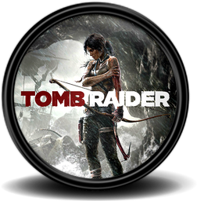
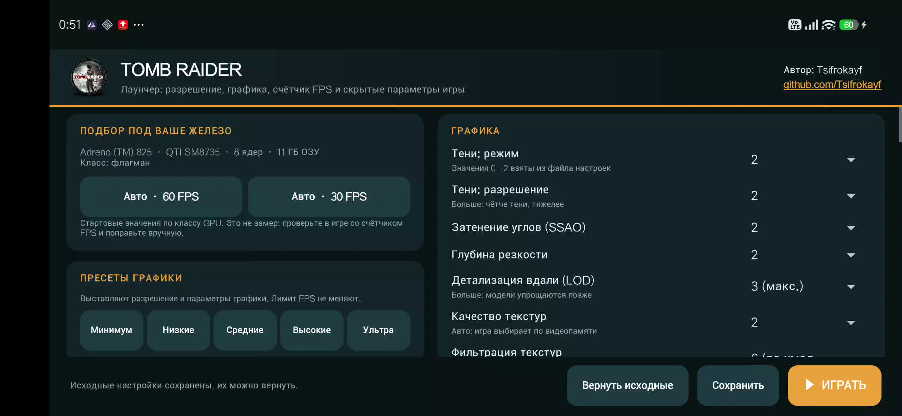
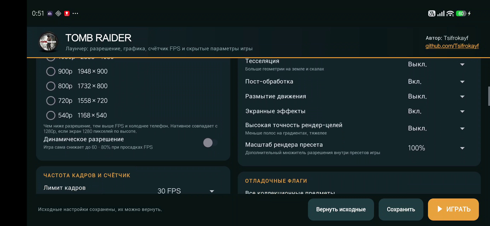
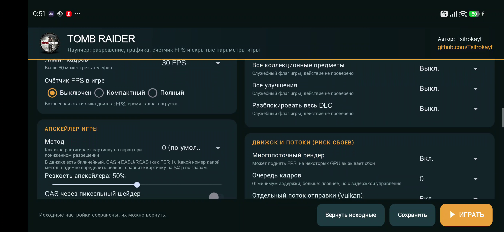
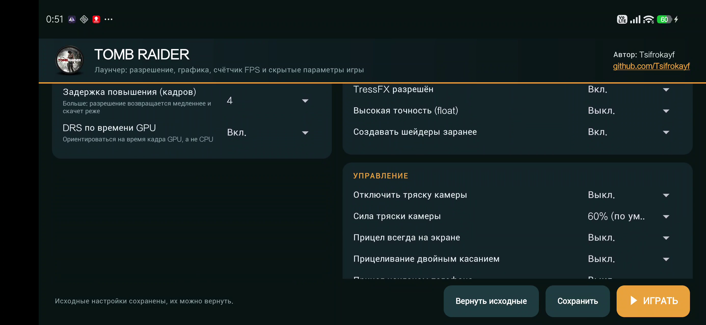
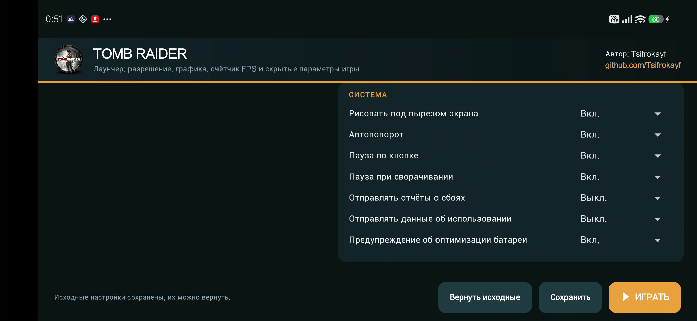

<p align="center">
  
</p>

<h1 align="center">Tomb Raider Launcher</h1>

<p align="center">
  Лаунчер для <b>Tomb Raider</b> (Android-порт Feral Interactive):<br>
  разрешение, графика, частота кадров, счётчик FPS и скрытые параметры игры, которых нет в её меню.
</p>

<p align="center">
  
</p>

> **English:** Tomb Raider Launcher is a small Android app that edits the preferences file of the Feral Interactive port of *Tomb Raider* (2013) through root or [Shizuku](https://shizuku.rikka.app/): render resolution, graphics quality, FPS limit, dynamic resolution, upscaler and hidden options, with hardware-based auto-tune and presets. It does not modify the game APK.

## Зачем это нужно

В Android-порте мало настроек: игра сама выбирает разрешение и качество, а лимит кадров и многие параметры недоступны.
Все эти значения лежат в одном файле настроек игры. Лаунчер читает и аккуратно правит именно этот файл, а потом запускает игру.

## Возможности

- **Подбор под ваше железо.** Кнопки «Авто · 60 FPS» и «Авто · 30 FPS» определяют класс GPU (Adreno, Mali, Immortalis, Xclipse; запасной вариант по ОЗУ и числу ядер) и выставляют стартовый набор настроек. Для Tomb Raider этот подбор собран из пресетов, таблицы Feral для этой игры в нём пока нет.
- **Пресеты графики:** «Минимум», «Низкие», «Средние», «Высокие», «Ультра». Лимит FPS пресеты не меняют.
- **Разрешение рендера:** нативное, 1280p, 1080p, 900p, 800p, 720p, 540p и динамическое разрешение (DRS).
- **Частота кадров:** лимит 30 / 40 / 60 / 90 / 120 FPS (только то, что поддерживает экран).
- **Счётчик FPS в игре:** встроенная статистика движка Feral: выключен / компактный / полный.
- **Графика по отдельности:** режим и разрешение теней, SSAO, глубина резкости, дальность LOD, качество и фильтрация текстур, сглаживание, высокая точность рендер-целей.
- **Апскейлер игры:** метод, резкость, CAS через пиксельный шейдер.
- **Скрытые параметры:** TressFX, DRS по времени кадра GPU, задержки повышения и снижения DRS, многопоточный рендер, очередь кадров, параметры Vulkan, тряска камеры, вибрация, прицел, система.
- **Root или Shizuku**, подсказки первичной настройки (мигающая красная строка и баннер с гайдом).
- **Резервная копия:** при первом сохранении создаётся копия исходного файла настроек, кнопка «Вернуть исходные» её восстанавливает.

<p align="center">
  
  
  
  
</p>

## Требования

- Android 11 или новее (`minSdk 30`).
- Установленная игра **Tomb Raider** (`com.feralinteractive.tombraider_android`).
- Доступ к папке игры: **root** (выдайте его лаунчеру в Magisk/KernelSU/APatch) **или** [Shizuku](https://shizuku.rikka.app/),
  запущенный и с выданным разрешением. Это нужно, потому что Android 11+ не даёт обычным приложениям писать в `Android/data` другого приложения.
- Игра должна быть запущена хотя бы один раз до главного меню: при этом создаётся файл настроек.

## Первая настройка (пошагово)

### 1. Дайте лаунчеру доступ к файлам игры

**Если есть root:** установите лаунчер (шаг 3), откройте его и нажмите «Проверить» в карточке «Первичная настройка». Разрешите root для «Tomb Raider Лаунчер» в вашем менеджере. Shizuku тогда не нужен, переходите к шагу 2.

**Если root нет, используйте Shizuku:**

1. Установите Shizuku из Google Play или со [страницы релизов](https://github.com/RikkaApps/Shizuku/releases).
2. Включите режим разработчика: **Настройки → О телефоне → Номер сборки**, нажмите 7 раз.
3. Откройте **Настройки → Для разработчиков → Беспроводная отладка** и включите её (нужна сеть Wi‑Fi).
4. В приложении Shizuku выберите **«Запуск через беспроводную отладку»**, затем **«Сопряжение»**:
   откройте в настройках «Сопряжение устройства с помощью кода», введите код в уведомление Shizuku.
5. Нажмите **«Запустить»**. Вверху должно появиться «Shizuku работает».

> Без root Shizuku нужно запускать заново после каждой перезагрузки телефона.
> Если доступа нет, лаунчер подскажет: строка статуса мигает красным, а при запуске показывается баннер с этим гайдом.

### 2. Запустите игру один раз

Установите игру, запустите её, дождитесь главного меню и закройте. Так создаётся файл настроек, который будет править лаунчер.

### 3. Установите лаунчер

1. Скачайте `TombRaider_Launcher.apk` со страницы [Releases](../../releases) и установите (разрешите установку из неизвестных источников для своего файлового менеджера или браузера).
2. Откройте **Tomb Raider Лаунчер**. При первом запуске лаунчер запросит доступ у Shizuku (нажмите **«Разрешить»**) или root.
3. В строке состояния внизу должно быть «Настройки загружены». Если там сообщение про Shizuku, проверьте, что он запущен (шаг 1).

### 4. Выберите настройки

1. Нажмите **«Авто · 60 FPS»** или **«Авто · 30 FPS»**: лаунчер выставит разрешение, графику, лимит кадров и DRS под класс вашего GPU.
   Либо выберите готовый **пресет** («Минимум» … «Ультра»), он не трогает лимит FPS.
2. Включите **«Счётчик FPS в игре» → «Компактный»**, чтобы видеть результат.
3. Нажмите **«▶ ИГРАТЬ»**. Лаунчер сам сохранит настройки, принудительно перезапустит игру и откроет её.
   Кнопка **«Сохранить»** только записывает настройки, не запуская игру.
4. Зайдите в игру на свой сохранённый момент и посмотрите на счётчик.

### 5. Доведите до нужного результата

Меняйте по одному параметру и проверяйте счётчик в одной и той же сцене.

| Что вы видите | Что менять |
|---|---|
| FPS ниже цели | Снизить разрешение, затем тени, SSAO, тесселяцию и дальность LOD |
| FPS ниже цели при низком разрешении | Упор в CPU: уменьшите плотность сцены и частицы, оставьте включённым многопоточный рендер |
| Картинка мутная | Выше разрешение, сглаживание, при необходимости апскейлер или масштаб рендера |
| Скачки разрешения | В блоке динамического разрешения поднимите минимальный масштаб |

### Что нужно знать

- После смены разрешения или графики игра заново прогревает шейдеры: в первые минуты возможны подлаги.
- После принудительной остановки игра может показать окно про «аварийную остановку». Это не сбой: выберите «Не отправлять».
- «Вернуть исходные» возвращает файл настроек, который был до первого сохранения из лаунчера.
- Если игра обновится или настройки сбросятся, откройте лаунчер заново: он перечитывает файл при запуске.

## Как это работает

Игра читает настройки из `Android/data/com.feralinteractive.tombraider_android/files/feral_app_support/preferences`
(XML в стиле реестра) при каждом запуске. Лаунчер читает этот файл командой `cat` (через `Shizuku.newProcess` или `su -c`), меняет нужные значения точечными заменами (форматирование файла не трогается),
записывает его обратно поверх (чтобы сохранить владельца) и запускает игру. APK игры не изменяется.

## Известные ограничения

- Нужен root или Shizuku. Без root Shizuku придётся запускать заново после перезагрузки телефона.
- Лаунчер правит только то, что игра читает из файла настроек. Часть значений взята из самого файла настроек и таблиц Feral, а не из меню игры, поэтому на другом железе проверяйте результат по счётчику FPS.
- Подбор «Авто» даёт стартовую точку, а не замер.
- Проверялось на POCO (Snapdragon, Adreno 825, Android 16).

## Сборка из исходников

Исходники трёх лаунчеров лежат в одном проекте: игра выбирается вариантом сборки.

```bash
# нужен Android SDK (platform 34) и Gradle 8.x
gradle assembleTrRelease    # Tomb Raider
gradle assembleHmRelease    # Hitman: Absolution
gradle assembleSr3Release   # Saints Row: The Third
# APK: app/build/outputs/apk/<вариант>/release/
```

Без своего ключа релиз подписывается отладочным ключом. Для своей подписи положите `launcher.jks` рядом с `settings.gradle` и задайте переменную `KS_PASS`.

## Другие лаунчеры

Та же идея для других портов Feral на Android:

- [SR3 Launcher](https://github.com/Tsifrokayf/sr3-launcher): Saints Row: The Third
- [Tomb Raider Launcher](https://github.com/Tsifrokayf/tomb-raider-launcher): Tomb Raider (2013)
- [Hitman Launcher](https://github.com/Tsifrokayf/hitman-launcher): Hitman: Absolution

## Отказ от ответственности

Проект неофициальный и не связан с Feral Interactive и правообладателями игр. Лаунчер не содержит файлов игр и не изменяет их APK. Изменение файла настроек делайте на свой риск; исходный файл сохраняется как резервная копия.

## Автор

[Tsifrokayf](https://github.com/Tsifrokayf)

## Лицензия

MIT, см. [LICENSE](LICENSE).
